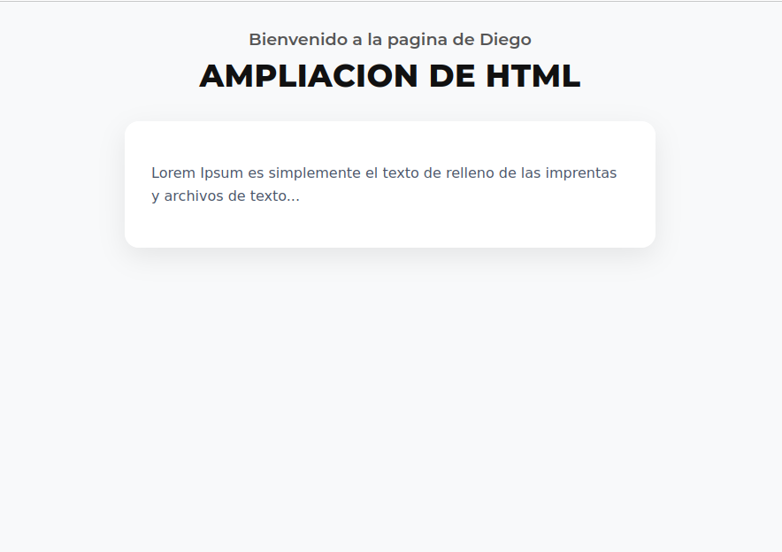
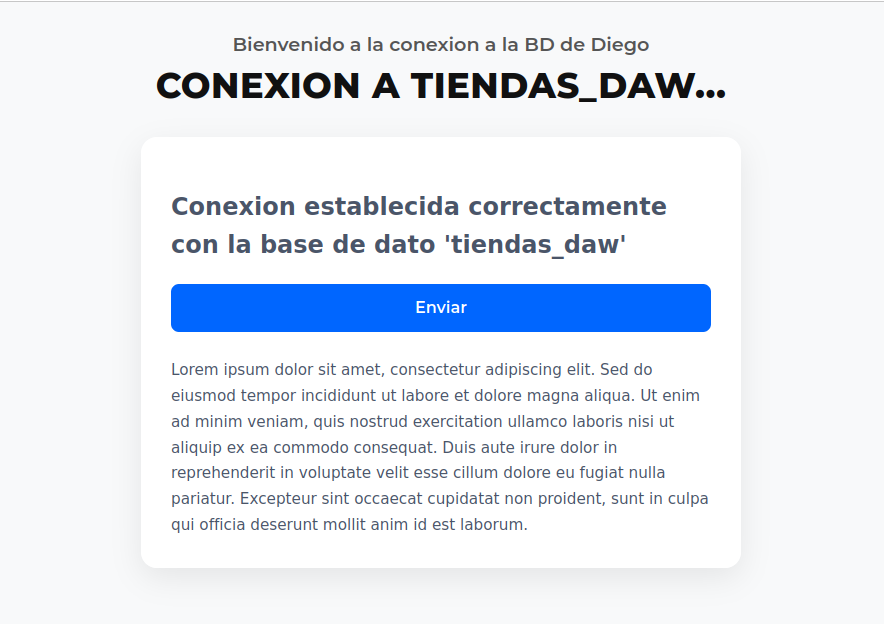
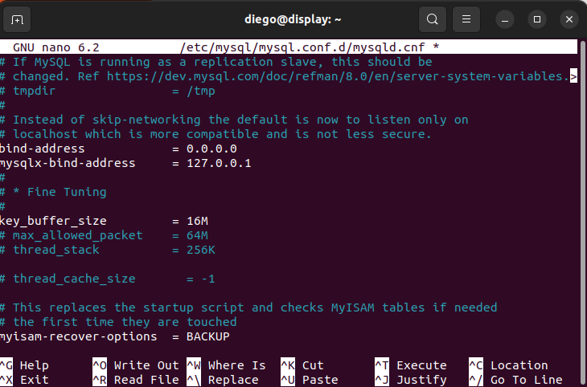
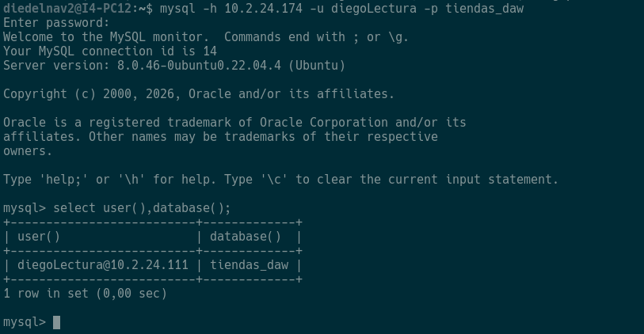

# Ampliacion Practica 1

> [!WARNING]
> Esto es una extension a la practica 1.
### POINT 1.
- #### `1. INDEX.HTML`
El codigo que hemos hecho es el siguiente: 
```html
<!DOCTYPE html>
<html lang="es">
<head>
  <meta charset="UTF-8">
  <meta name="viewport" content="width=device-width, initial-scale=1.0">
  <title>Página de Diego</title>
  <!-- Tipografía comercial Montserrat -->
  <link rel="preconnect" href="https://fonts.googleapis.com">
  <link rel="preconnect" href="https://fonts.gstatic.com" crossorigin>
  <link href="https://fonts.googleapis.com/css2?family=Montserrat:wght@600;700;800&display=swap" rel="stylesheet">
  <link rel="stylesheet" href="stylees.css">
</head>
<body>

  <!-- Sección de encabezados superiores -->
  <header class="top-header">
    <p class="welcome-text">Bienvenido a la pagina de Diego</p>
    <h1 class="main-title">Ampliacion de HTML</h1>
  </header>

  <!-- Contenedor principal para la tarjeta de texto -->
  <main class="main-content">
    <div class="card">
      <p>
        Lorem Ipsum es simplemente el texto de relleno de las imprentas y archivos de texto...
      </p>
    </div>
  </main>

</body>
</html>
```

Y asi queda:



- #### `2. INDEX.PHP`
El codigo que hemos usado es el siguiente:
```php
<!DOCTYPE html>
<html lang="es">
<head>
  <meta charset="UTF-8">
  <meta name="viewport" content="width=device-width, initial-scale=1.0">
  <title>Página de Diego</title>

  <!-- Fuente comercial Montserrat -->
  <link rel="preconnect" href="https://fonts.googleapis.com">
  <link rel="preconnect" href="https://fonts.gstatic.com" crossorigin>
  <link href="https://fonts.googleapis.com/css2?family=Montserrat:wght@500;600;700;800&display=swap" rel="stylesheet">

  <link rel="stylesheet" href="stylees.css">
</head>
<body>

  <!-- Sección de encabezados superiores -->
  <header class="top-header">
    <p class="welcome-text">Bienvenido a la conexion a la BD de Diego</p>
    <h1 class="main-title">Conexion a tiendas_daw...</h1>
  </header>

  <!-- Contenedor principal -->
  <main class="main-content">
    <div class="card">
      
      <!-- Contenido dentro del div -->
      <div class="div-content">
       	<?php
		$servidor = "localhost";
		$usuario = "appuser";
		$contrasena = "ContraseñaSegura2026!";
		$bd = "tiendas_daw";

		$conexion = new mysqli($servidor, $usuario, $contrasena, $bd);

		if($conexion->connect_error){
        		die("Error de conexion: " . $conexion->connect_error);
		}

		echo "<h2>Conexion establecida correctamente con la base de dato '$bd' </h2>";

		$conexion->close();     
	?>

      </div>

      <!-- Botón alargado azul debajo del div -->
      <button type="submit" class="btn-enviar">Enviar</button>

      <!-- Texto largo debajo del div y del botón -->
      <p class="long-text">
        Lorem ipsum dolor sit amet, consectetur adipiscing elit. Sed do eiusmod tempor incididunt ut labore et dolore magna aliqua. Ut enim ad minim veniam, quis nostrud exercitation ullamco laboris nisi ut aliquip ex ea commodo consequat. Duis aute irure dolor in reprehenderit in voluptate velit esse cillum dolore eu fugiat nulla pariatur. Excepteur sint occaecat cupidatat non proident, sunt in culpa qui officia deserunt mollit anim id est laborum.
      </p>

    </div>
  </main>

</body>
</html>

```

y esto se ve asi:


- #### `3. INDEX.CSS`

Este es el codigo que hemos usado para las dos paguinas:

```css
body {
  margin: 0;
  padding: 30px 20px;
  background-color: #f8f9fa;
  display: flex;
  flex-direction: column;
  align-items: center;
  font-family: Arial, sans-serif;
}

/* Estilos del encabezado superior */
.top-header {
  text-align: center;
  margin-bottom: 30px;
}

.welcome-text {
  font-family: 'Montserrat', sans-serif;
  font-size: 1.2rem;
  font-weight: 600;
  color: #555555;
  margin: 0 0 8px 0;
}

/* Botón alargado azul */
.btn-enviar {
  width: 100%;
  padding: 14px 20px;
  background-color: #0066ff;
  color: #ffffff;
  font-family: 'Montserrat', sans-serif;
  font-size: 1rem;
  font-weight: 600;
  border: none;
  border-radius: 8px;
  cursor: pointer;
  transition: background-color 0.2s ease, transform 0.1s ease;
  margin-bottom: 25px;
}

.btn-enviar:hover {
  background-color: #0052cc;
}

.btn-enviar:active {
  transform: scale(0.99);
}

/* Texto largo inferior */
.long-text {
  color: #4a5568;
  line-height: 1.7;
  font-size: 0.95rem;
  margin: 0;
}


.main-title {
  font-family: 'Montserrat', sans-serif;
  font-size: 2.2rem;
  font-weight: 800;
  color: #111111;
  margin: 0;
  text-transform: uppercase;
  letter-spacing: 0.5px;
}

/* Estilos de la tarjeta con sombra */
.main-content {
  width: 100%;
  max-width: 600px;
}

.card {
  background-color: #ffffff;
  padding: 30px;
  border-radius: 16px;
  box-shadow: 0px 10px 30px rgba(0, 0, 0, 0.08);
  color: #4a5568;
  line-height: 1.6;
}
```
### POINT 2.
Comandos a ejecutar: 
> - CREATE USER 'diegoLectura'@'10.2.24.111' IDENTIFIED BY 'diegoLectura123!';
> - GRANT SELECT ON tiendas_daw.* TO 'diegoLectura'@'10.2.24.111';

Una vez hacemos esos **comandos** tenemos que modificar en el archivo de configuracion de **MYSQL** la siguiente linea llamada **BIND**: 


Y reiniciamos el servicio.

### POINT 3.
En la maquina **LLIUREX** haz el siguiente comando: 
> mysql -h 10.2.24.174 -u diegoLectura -p tiendas_daw

y accedemos a la **BD**:
