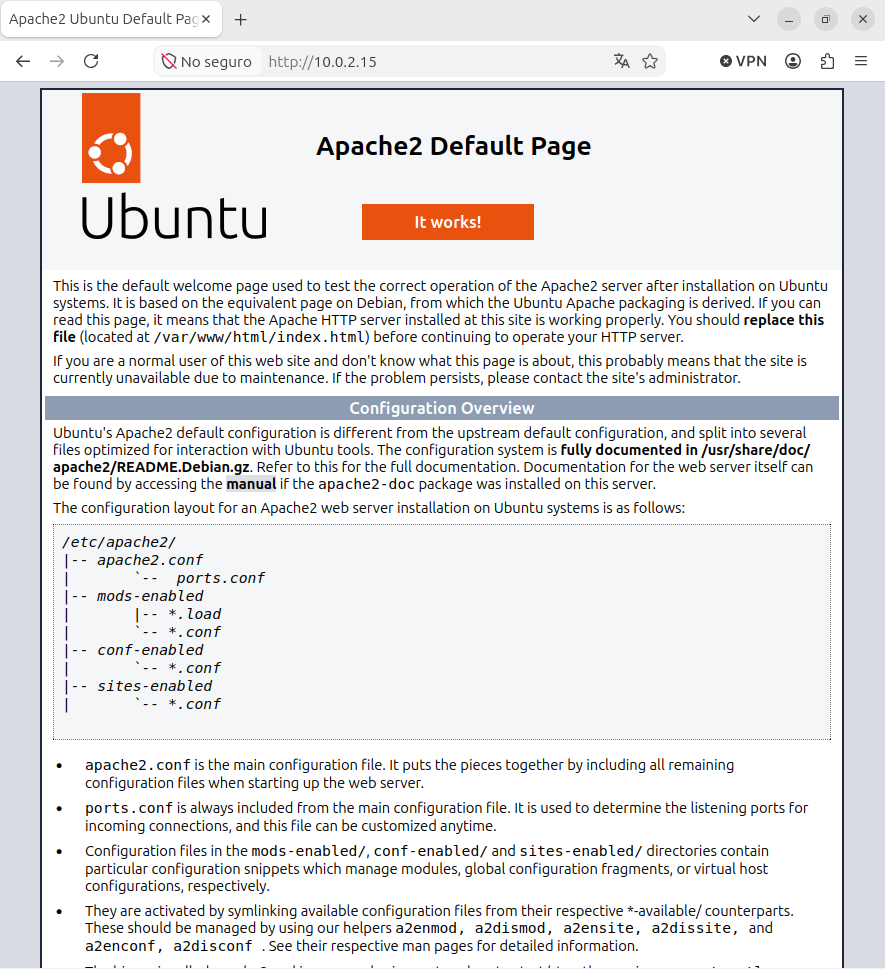
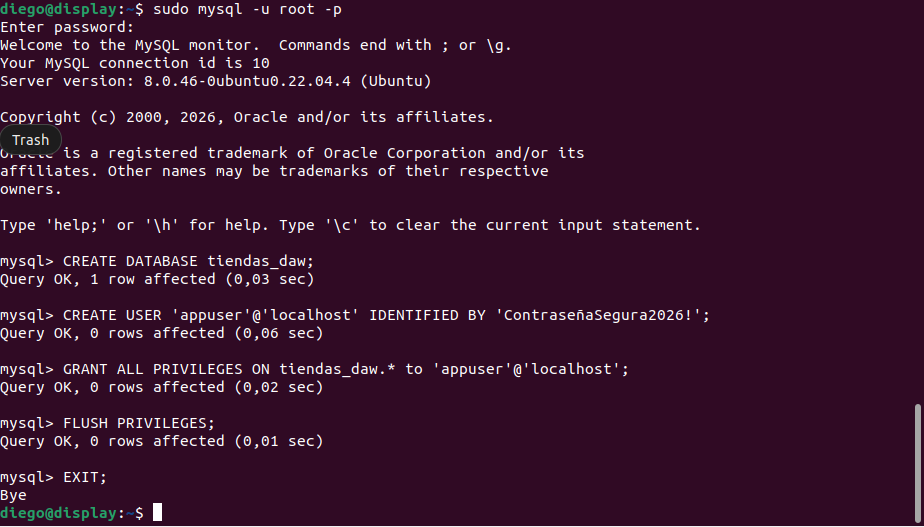
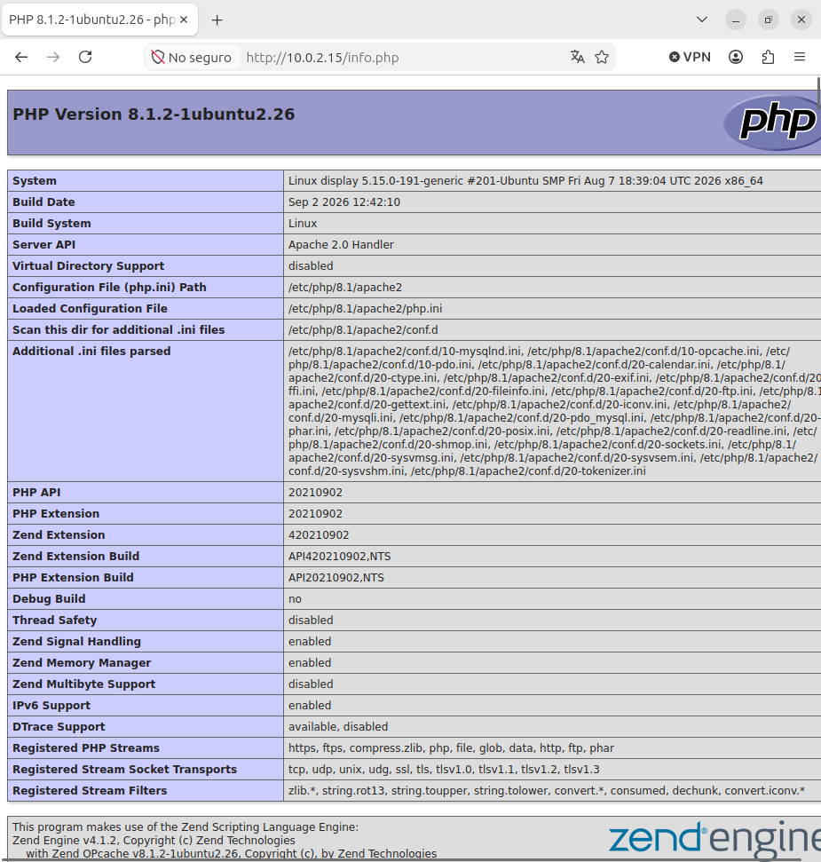
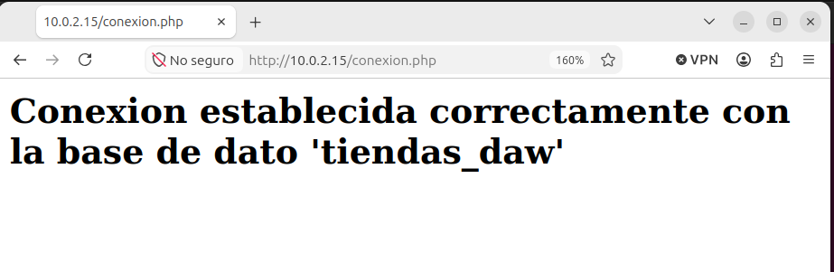

## PREPARANDO  `LAMP`

#### `CAP 1`

En esta captura hemos accedido con la **IP** de nuestro servidor a la pagina **WEB** de nuestro ***APACHE*** :


---
**Pregunta de reflexión:** ¿Por qué es una mala práctica dejar el acceso remoto abierto para el usuario root de la base de datos?
**Respuesta:** Es mala practica ya que varios usuarios pueden entrar a ese usuario de manera remota y pueden haber colisiones, ademas, *root* es un usuario administrador si alguien externo consigue entrar tiene todo el acceso a la **BD**.


#### `CAP 2`

En esta captura tenemos que acceder a **MYSQL** y crear una **BD** y un usuario y luego darle **permisos** a ese usuario sobre la **BD**:


---

#### `CAP 3`

En esta captura vamos a ver una pagina **PHP** que hemos creado despues de hacer una serie de comandos que instalaban **PHP**.


>- El codigo que hemos insertado dentro de la ruta `/var/www/html/conexion.php`
>  ```php
>    <?php
>        phpinfo();
>    ?>
>  ```

Y asi queda la pagina:


---

#### `CAP 4`

Hacemos un archivo **PHP** y creamos una conexion entre los 3:



---

**Pregunta de reflexión:** identifica en este script cuál es la capa de presentación, cuál la de lógica de negocio y cuál la de datos.
```php
    <?php
    $servidor = "localhost";
    $usuario = "appuser";
    $contrasena = "ContrasenaSegura2026!";
    $bd = "tienda_daw";
    $conexion = new mysqli($servidor, $usuario, $contrasena, $bd);
    if ($conexion->connect_error) {
    die("Error de conexión: " . $conexion->connect_error);
    }
    echo "<h2>Conexión establecida correctamente con la base de datos '$bd'</h2>";
    $conexion->close();
    ?>
```
- **CAPA DE PRESENTACION**: `.php = die\echo (es lo que se muestra).`.
- **LOGICA DE NEGOCIO**: `Condiconales = if`.
- **DATOS**: `Base de datos = $bd = "tiendas_daw"`.
---

