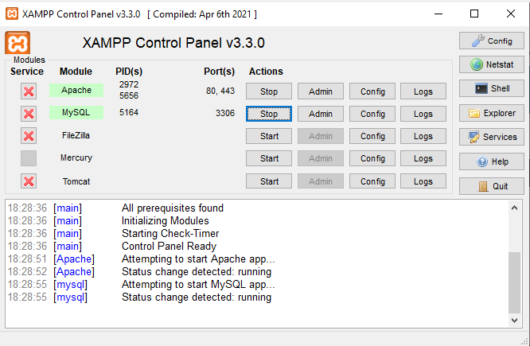
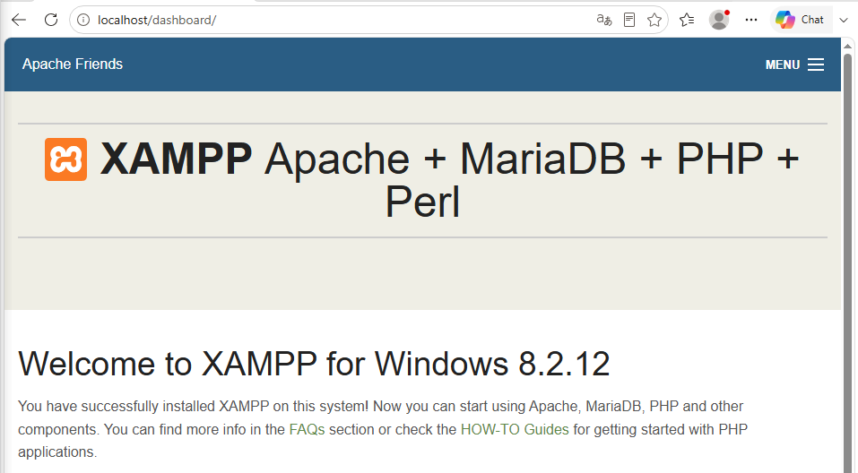
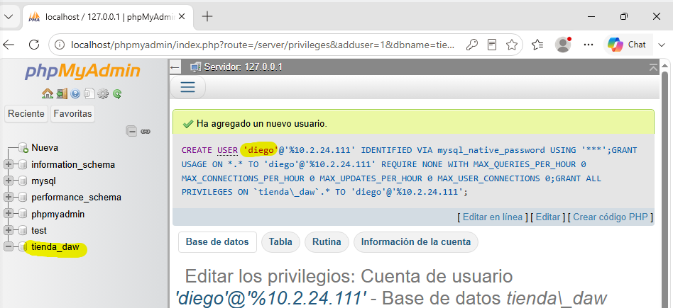
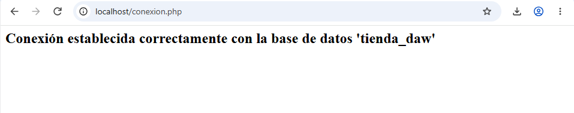

# XAMP
>[!NOTE]
> ### `PREGUNTAS EN LA MEMORIA`
> 
>  ¿Por qué crees que es importante descargar el software siempre desde la web oficial y no desde un enlace de terceros?
> **Respuesta**: Porque el hay un software adaptado a cada sistema operativo.
> 
>  ¿qué ventajas y qué inconvenientes ves en usar una herramienta gráfica como phpMyAdmin frente a escribir los comandos SQL directamente en consola, como hicisteis en la actividad de LAMP?
> **Respuesta**: Que debes de moverte mucho mas por el sistema en cambio desde la terminal trabajas mas rapido.

---

> `CAPTURA 1`
> 
>captura de pantalla del Panel de Control con Apache y MySQL en marcha (en verde).
> 
>
> `CAPTURA 2`
>
>Captura de pantalla del panel de bienvenida de XAMPP en el navegador.
>
>
> `CAPTURA 3`
> 
> Captura de pantalla de la base de datos tienda_daw creada en phpMyAdmin.
>
>
> `CAPTURA 4`
>
>Captura de pantalla del mensaje de conexión correcta
>

Diego Heber De Leon Navarro

