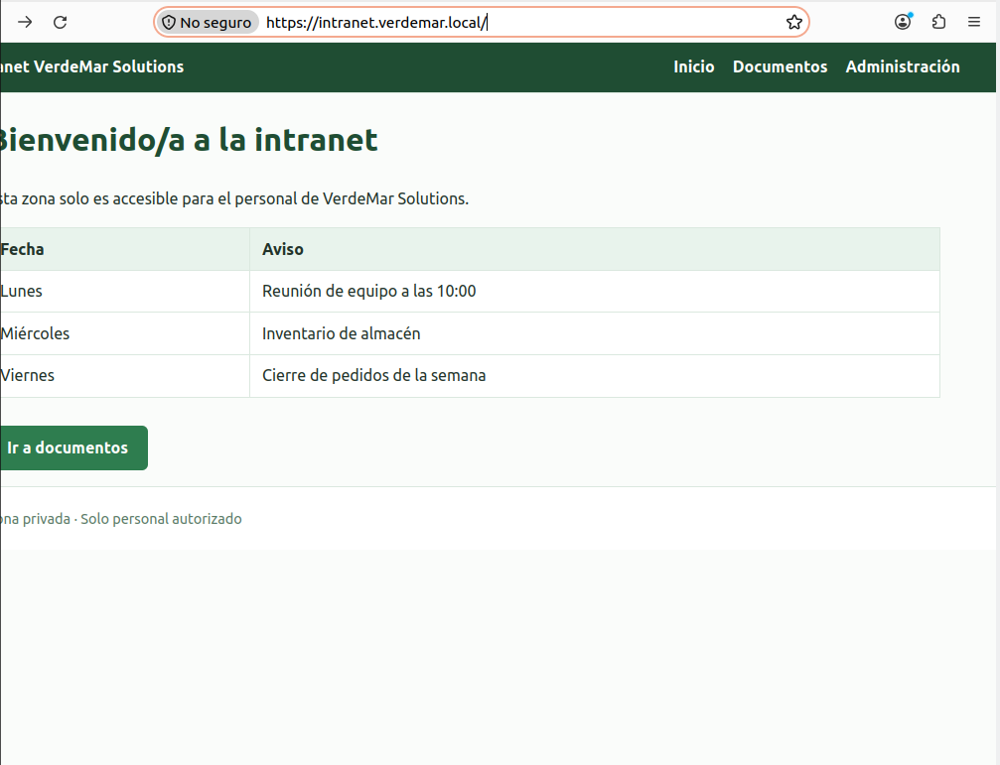
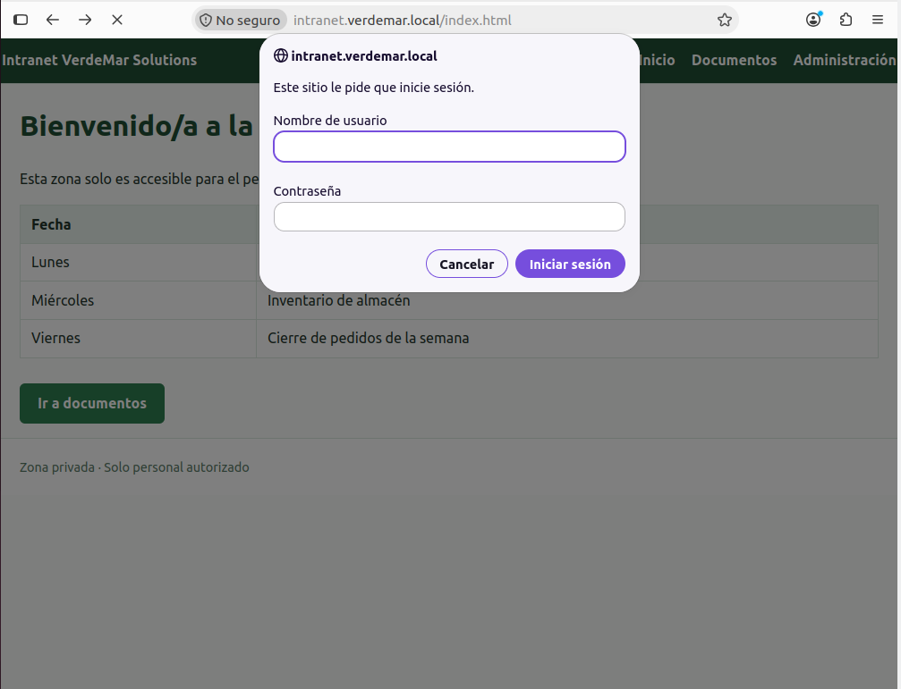
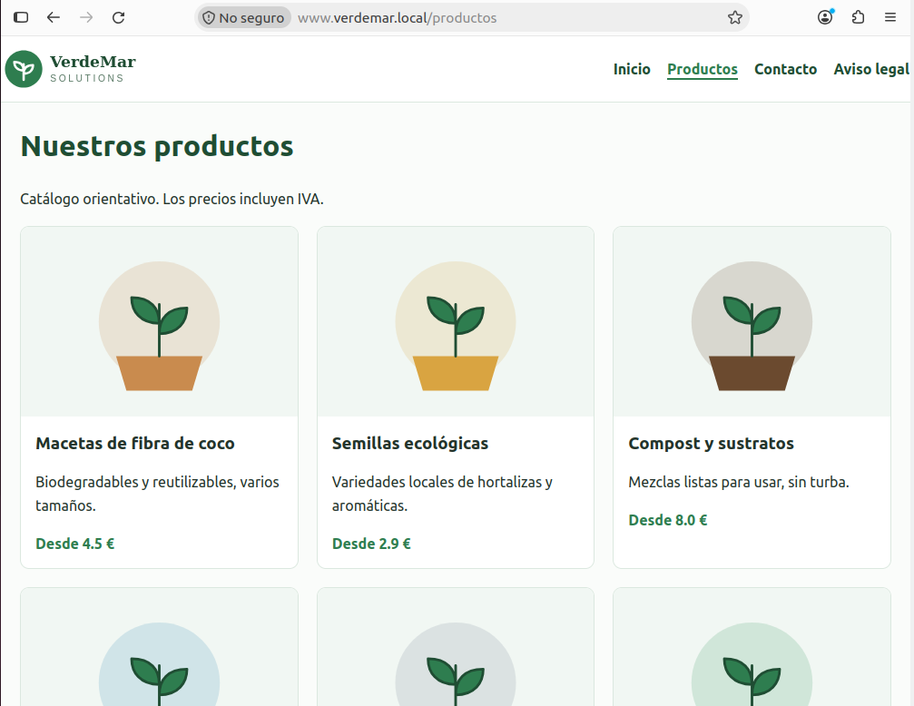
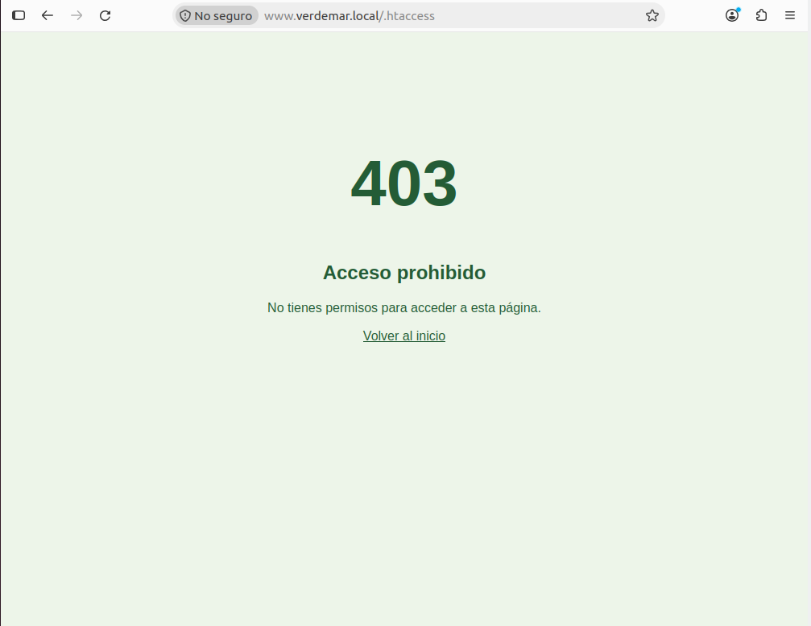
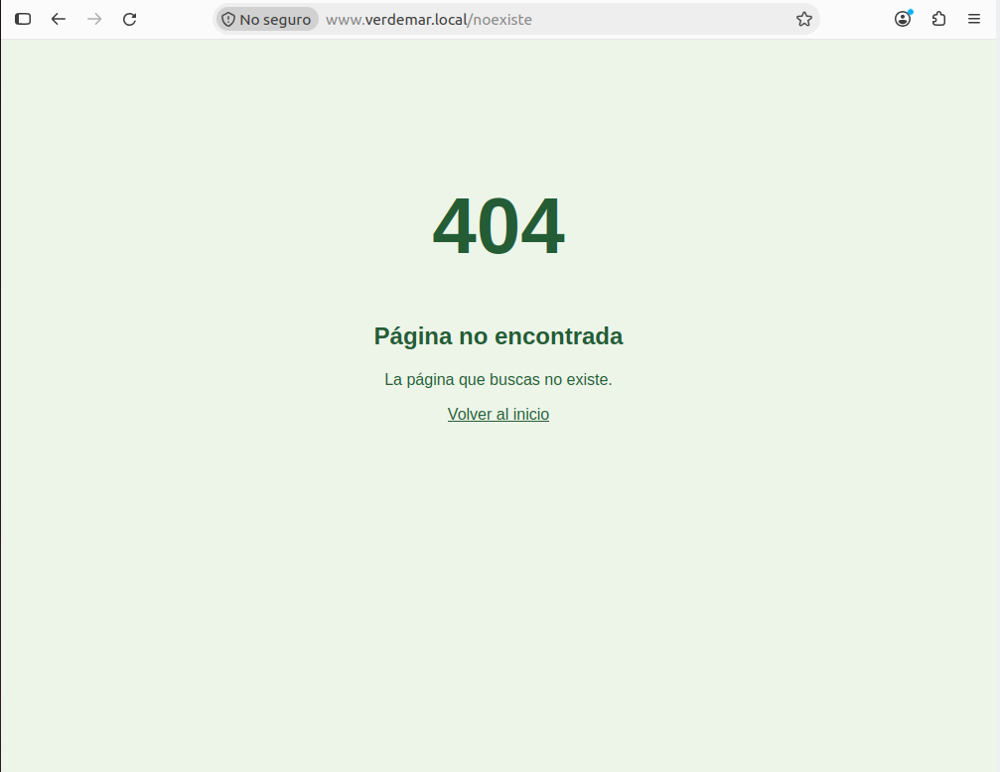

# PROYECTO APACHE

## FASE 1

`ENUNCIADO:`

Fase 1. Instalación y estructura
1. Instalar Apache 2.4 y comprobar el servicio con systemctl status apache2 y apache2ctl -v.
2. Crear la estructura de directorios: /var/www/verdemar/public y /var/www/verdemar/intranet, con propietario www-data y permisos mínimos necesarios (directorios 755, ficheros 644).
a. sudo find /var/www/prueba.com -type d -exec chmod 755 {} \;
b. sudo find /var/www/prueba.com -type f -exec chmod 644 {} \;
3. Desactivar el sitio por defecto y el módulo o configuración que no se use

`RESULTADO:`

Hemos dado los permisos, hemos desactivados los demas sitios y hemos reiniciado el servicio de apache.

## FASE 2 

`ENUNCIADO:`

Fase 2. Hosts virtuales por nombre
1. Un fichero .conf por sitio en sites-available, activado con a2ensite. Nada de modificar 000-default.conf ni meter todo en apache2.conf.
2. ServerName, ServerAdmin, DocumentRoot, ErrorLog y CustomLog propios para cada sitio.
3. Acceso desde otro equipo (o desde el anfitrión) por nombre, con las entradas necesarias en /etc/hosts o servidor DNS.

`RESPUESTA:`

La primera pagina despues de cambiar `etc/hosts`:

La segunda pagina despues de cambiar `etc/hosts`:

## FASE 3

`ENUNCIADO:`

Fase 3. HTTPS y redirecciones
1. Generar un certificado autofirmado con openssl que incluya ambos dominios, con clave de 2048 bits como mínimo.
2. Publicar ambos sitios en el puerto 443.
3. Redirigir todo el tráfico HTTP (80) a HTTPS con 301.
4. Redirigir verdemar.local (sin www) a www.verdemar.local.

`RESPUESTA:`

Despues de activar y configurar todo el `https`:

Y comprobandolo desde el navegador aparece: 

## FASE 4

`ENUNCIADO:`

Fase 4. Control de acceso y seguridad
1. Proteger la intranet con autenticación básica (AuthType Basic) y fichero .htpasswd fuera del DocumentRoot, con 3 usuarios distintos.
2. Restringir una subcarpeta intranet/admin solo a un usuario concreto y, además, a la red del laboratorio.
3. Desactivar el listado de directorios (Options -Indexes) en todo el servidor y permitirlo solo en intranet/documentos.
4. Bloquear el acceso al fichero .htaccess

`RESPUESTA:`

Al iniciar la pagina salta el usuario: 

Si pones el usuario sale lo siguiente: 

Si pones un usuario que no esta verificado no accedes.

## FASE 5

`ENUNCIADO:`

Fase 5. Rendimiento, URL y registros
1. Comprimir HTML, CSS y JS con mod_deflate. Investiga
2. Caché del navegador con mod_expires (imágenes y CSS: 30 días; HTML: sin caché larga). Investiga
3. URL amigables con mod_rewrite en .htaccess: /productos debe servir productos.html sin mostrar la extensión.
4. Páginas de error personalizadas 403, 404 y 500, con el estilo de la web.

`RESPUESTA:`

Al hacer todos los pasos de la conf del htacces y del archivo de rendimiento, etc...
Podremos acceder sin poner el `.html`.

Si accedes a una pagina que debe saltar un error nos damos cuenta que pilla bien las paginas de error.

Pagina no encontrada

## FASE 6

> [!NOTE]
>
> Por lo tengo entendido es una prueba de que todo funciona asi que para eso tienes el ZIP, (TRABAJA)...

