# Ejercicio Imagenes en Docker
Vamos a realizar 6 ejercicios en total:

## Ejercicio 1

###### Enunciado:

Se tiene una carpeta html con una web estática (index.html) y se pide crear una
imagen Docker con el servidor web Apache que muestre la web.
Requisitos:
● Imagen base: debian
● Comandos para instalar Apache:
○ apt-get update
○ apt-get install -y apache2
○ apt-get clean
○ rm -rf /var/lib/apt/lists/*
● Debe exponer el puerto 80
● Comando para ejecutar Apache: /usr/sbin/apache2ctl -D FOREGROUND

###### Respuesta:

Vamos a preparar la estructura de archivos:

```bash
diego@display:~$ cd Documentos/
diego@display:~/Documentos$ ls
diego@display:~/Documentos$ mkdir ejercicio1
diego@display:~/Documentos$ ls
ejercicio1
diego@display:~/Documentos$ cd ejercicio1
diego@display:~/Documentos/ejercicio1$ sudo nano Dockerfile
diego@display:~/Documentos/ejercicio1$ cd Dockerfile/
diego@display:~/Documentos/ejercicio1$ mkdir html
diego@display:~/Documentos/ejercicio1$ cd html
diego@display:~/Documentos/ejercicio1/html$ sudo nano index.html
```

Todo esto nos quedaria asi:

```
ejercicio1/
├── Dockerfile
└── html/
    └── index.html
```
Y dentro del el archivo de Dockerfile ponemos lo siguiente:

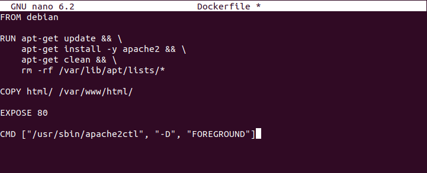

Una vez hecho todo esto tenemos que construir la imagen:

```bash
docker build -t apache-ejercicio1 .
```

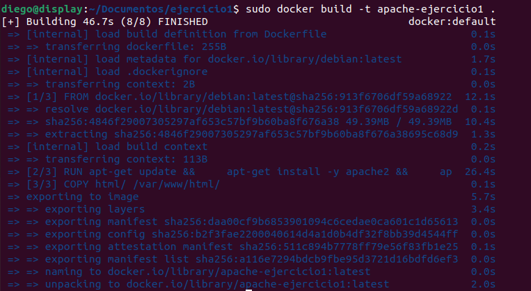

Ahora ejecutamos el contenedor:

```bash
docker run -d -p 8080:80 --name web1 apache-ejercicio1
```

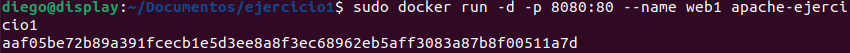

Despues de todo tenemos que comprobar que ha funcionado:

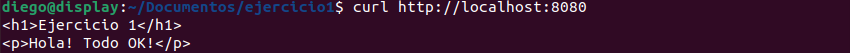

## Ejercicio 2

###### Enunciado: 
Repite el ejercicio 1 pero usando como imagen base la oficial de Apache.

###### Respuesta:

Creamos otra vez la estructura:

```
ejercicio2/
├── Dockerfile
└── html/
    └── index.html
```

Y hacemos el Dockerfile y el HTML

```bash
diego@display:~/Documentos$ mkdir ejercicio2
diego@display:~/Documentos$ mkdir html
diego@display:~/Documentos$ sudo nano Dockerfile

diego@display:~/Documentos$  cd html
diego@display:~/Documentos/html$ sudo nano index.html
diego@display:~/Documentos/html$ cat index.html
<h1>Ejercicio 2</h1>
<p>Hola! Todo OK!</p>

diego@display:~/Documentos/html$ cd ..
diego@display:~/Documentos$ cat Dockerfile 
FROM httpd

COPY html/ /usr/local/apache2/htdocs/

EXPOSE 80
```

Construimos la imagen:

```bash
docker build -t apache-ejercicio2 .
```
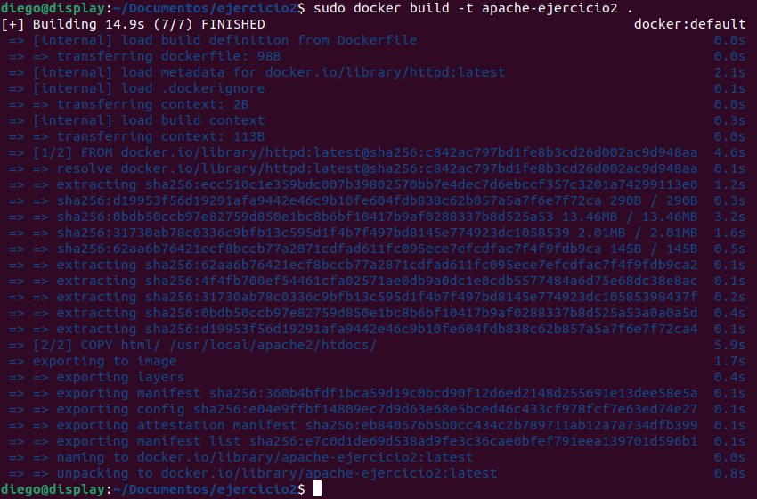

Y construimos el contenedor:

```bash
docker run -d -p 8081:80 --name web2 apache-ejercicio2
```
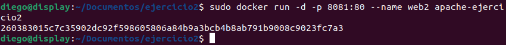

Y veamos como funciona:
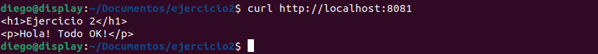


## Ejercicio 3

###### Enunciado:

Repite el ejercicio 2 pero usando como imagen base la oficial de Nginx.

###### Respuesta:

Tenemos que hacer esta estructura:

```bash
diego@display:~/Documentos$ mkdir ejercicio3
diego@display:~/Documentos$ cd ejercicio3

diego@display:~/Documentos/ejercicio3$ mkdir html
diego@display:~/Documentos/ejercicio3$ sudo nano Dockerfile

diego@display:~/Documentos/ejercicio3$ cd html
diego@display:~/Documentos/ejercicio3/html$ sudo nano index.html

diego@display:~/Documentos/ejercicio3/html$ cat index.html 
<h1>Ejercicio 3</h1>
<p>Hola! Todo OK!</p>

diego@display:~/Documentos/ejercicio3/html$ cd ..
diego@display:~/Documentos/ejercicio3$ cat Dockerfile 
FROM nginx

COPY html/ /usr/share/nginx/html/

EXPOSE 80

```

Ahora construimos la imagen:
```bash
docker build -t nginx-ejercicio3 .
```
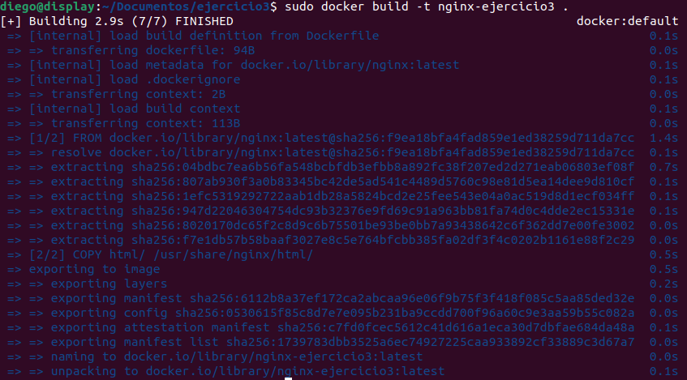

Ahora creamos/ejecutamos el contenedor:
```bash
docker run -d -p 8082:80 --name web3 nginx-ejercicio3
```
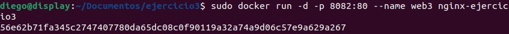

Comprobamos que funciona:

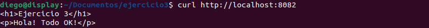

## Ejercicio 4

###### Enunciado:

Se tiene una carpeta app con una página web dinámica con php (index.php) y se
pide crear una imagen Docker con el servidor web Apache y php que muestre la
web.
Requisitos:
● Imagen base: debian
● Comandos para instalar Apache:
○ apt-get update
○ apt-get install -y apache2 libapache2-mod-php7.3 php7.3
○ apt-get clean
○ rm -rf /var/lib/apt/lists/*
○ rm /var/www/html/index.html
● Debe exponer el puerto 80
● Comando para ejecutar Apache: /usr/sbin/apache2ctl -D FOREGROUND

Creamos la estructura de datos:

```bash
diego@display:~/Documentos$ sudo mkdir ejercicio4
diego@display:~/Documentos$ cd ejercicio4

diego@display:~/Documentos/ejercicio4$ sudo mkdir app
diego@display:~/Documentos/ejercicio4$ sudo nano Dockerfile

diego@display:~/Documentos/ejercicio4$ cd app
diego@display:~/Documentos/ejercicio4/app$ sudo nano index.php

diego@display:~/Documentos/ejercicio4/app$ cat index.php 
<?php echo phpinfo(); ?>

diego@display:~/Documentos/ejercicio4/app$ cd ..
diego@display:~/Documentos/ejercicio4$ cat Dockerfile 
FROM debian

RUN apt-get update && \
    apt-get install -y apache2 libapache2-mod-php php && \
    apt-get clean && \
    rm -rf /var/lib/apt/lists/* && \
    rm /var/www/html/index.html

COPY app/ /var/www/html/

EXPOSE 80

CMD ["/usr/sbin/apache2ctl", "-D", "FOREGROUND"]

```

Construir la imagen: 
```bash
docker build -t apache-php-ejercicio4 .
```
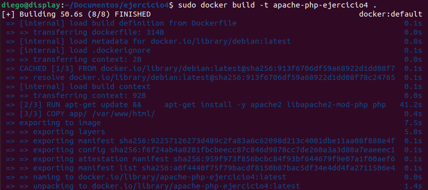

Construir el contenedor:
```bash
docker run -d -p 8083:80 --name web4 apache-php-ejercicio4
```
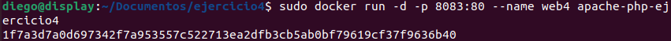

Y ahora comprobamos como funciona:
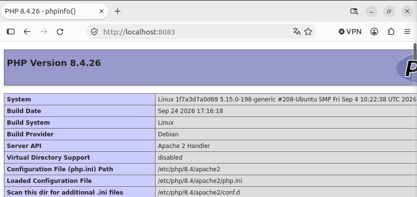

## Ejercicio 5

###### Enunciado: 

Repite el ejercicio 4 pero usando como imagen base php:apache, que es una imagen de oficial de PHP con Apache ya instalado.

###### Respuesta:

Creamos la estructura de datos: 
```bash
diego@display:~/Documentos$ sudo mkdir ejercicio5
diego@display:~/Documentos$ cd ejercicio5

diego@display:~/Documentos/ejercicio5$ sudo mkdir app
diego@display:~/Documentos/ejercicio5$ sudo nano Dockerfile

diego@display:~/Documentos/ejercicio5$ cd app/
diego@display:~/Documentos/ejercicio5/app$ sudo nano index.php

diego@display:~/Documentos/ejercicio5/app$ cat index.php 
<?php echo phpinfo(); ?>

diego@display:~/Documentos/ejercicio5/app$ cd ..

diego@display:~/Documentos/ejercicio5$ cat Dockerfile 
FROM php:apache

COPY app/ /var/www/html/

EXPOSE 80
```

Construimos la imagen: 
```bash
docker build -t php-apache-ejercicio5 .
```
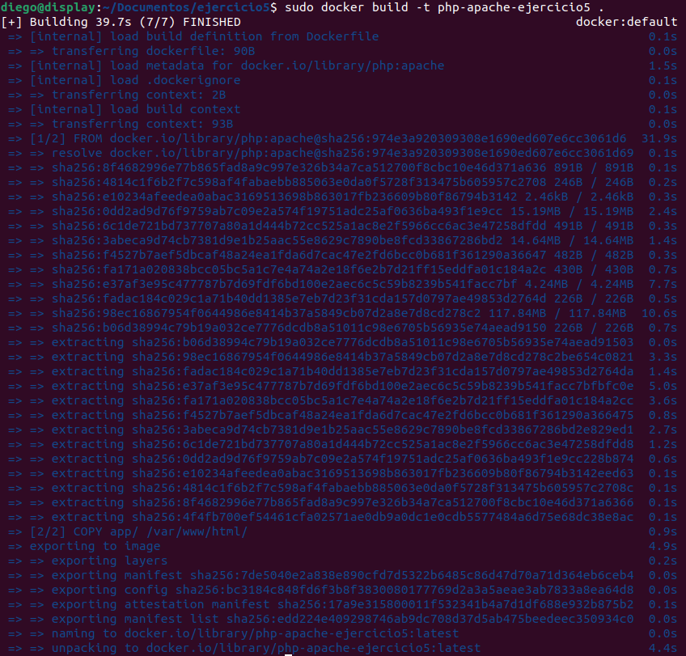

Construimos el contenedor:
```bash
docker run -d -p 8084:80 --name web5 php-apache-ejercicio5
```
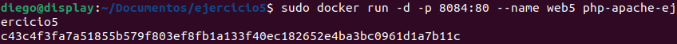

Y ahora comprobamos que funciona:
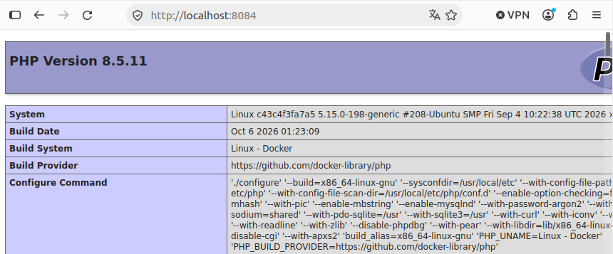

## Ejercicio 6

###### Enunciado:

Crea una cuenta el Docker Hub, creo una imagen y súbela.
Puede utilizar una imagen de las creadas en el los ejercicios anteriores.
Recuerda que la primera parte del nombre de la imagen tiene que coincidir con el
numbre de usuario de Docker Hub.
Luego borra la imagen local y usa docker run para que se la descargue del
repositorio, cree un contenedor y lo ejecute.
Documenta el proceso con explicaciones y capturas de pantalla.

###### Respuesta:

Creamos la cuenta en **Docker Hub**:
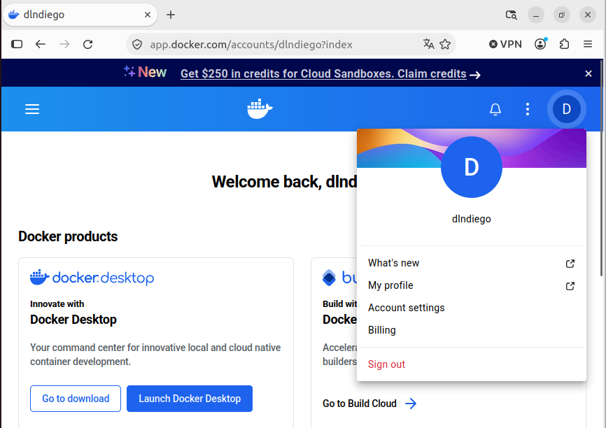

Ahora iniciamos sesion desde el terminal:
```bash
docker login
```
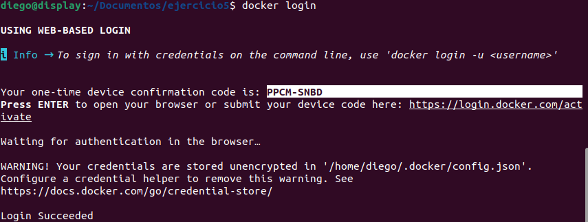

Le ponemos un **TAG** a una imagen existente:
```bash
docker tag apache-ejercicio2 dlndiego/apache-ejercicio2:v1
```
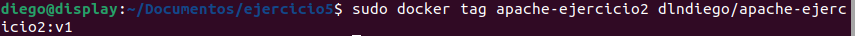

Tnemos que hacer el **push** a la image: de esta manera: 
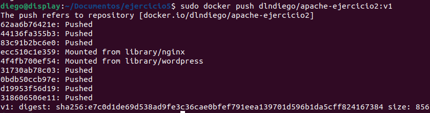

y si accedemos a nuestro perfil vemos como se ha subido la imagen:
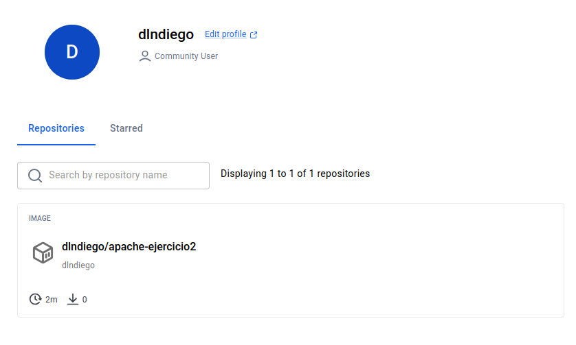

Ahora borramos el contenedor local:

```bash
docker ps -a
docker stop web2
docker rm web2
```

y ahora las imagenes
```bash
diego@display:~/Documentos/ejercicio5$ sudo docker rmi dlndiego/apache-ejercicio2:v1
Untagged: dlndiego/apache-ejercicio2:v1
Deleted: sha256:e7c0d1de69d538ad9fe3c36cae0bfef791eea139701d596b1da5cff824167384
diego@display:~/Documentos/ejercicio5$ sudo docker rmi apache-ejercicio2
Error response from daemon: No such image: apache-ejercicio2:latest
```

y comprobamos que no estan con el docker images:

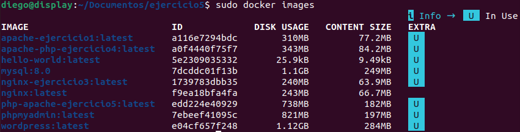

y ahora la ejecutamos desde **DOCKER HUB**:
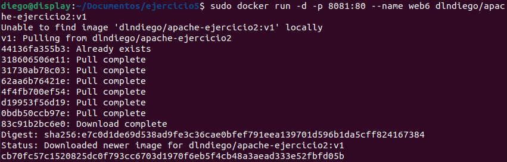

Y comprobamos que funciona:

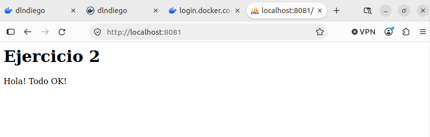