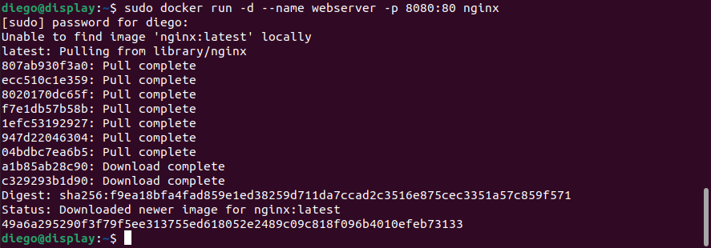
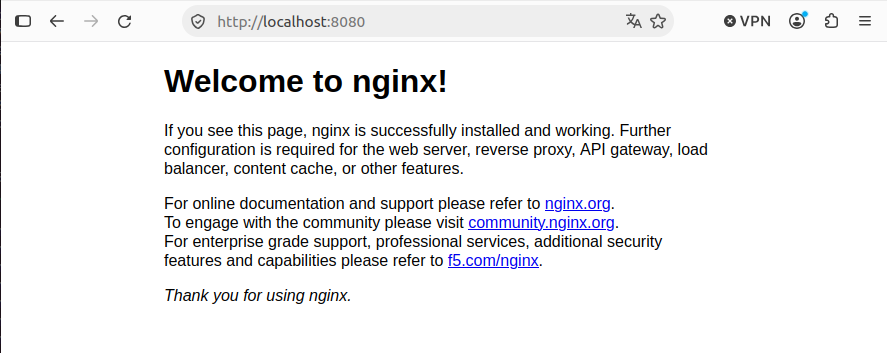
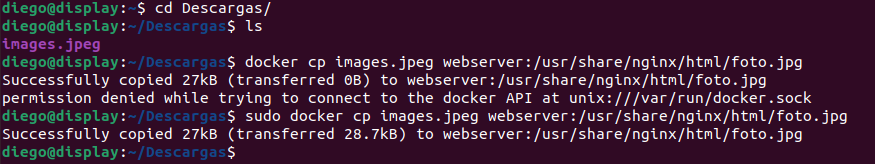
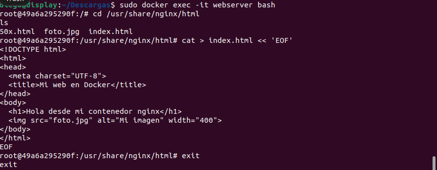
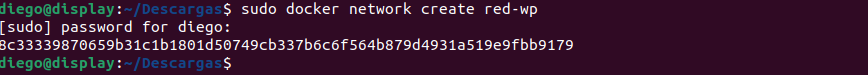
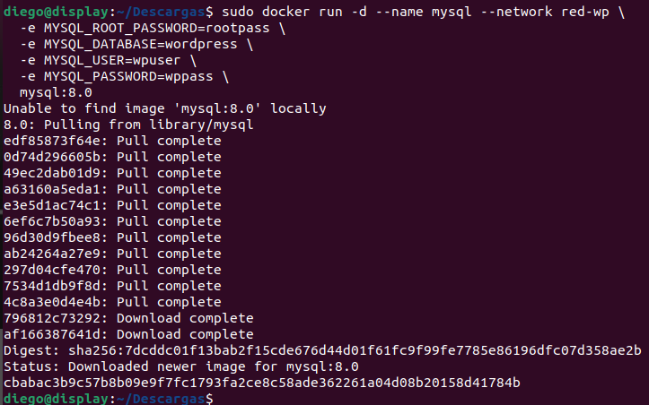
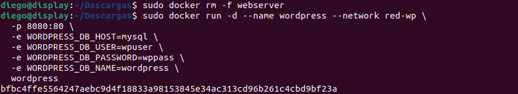
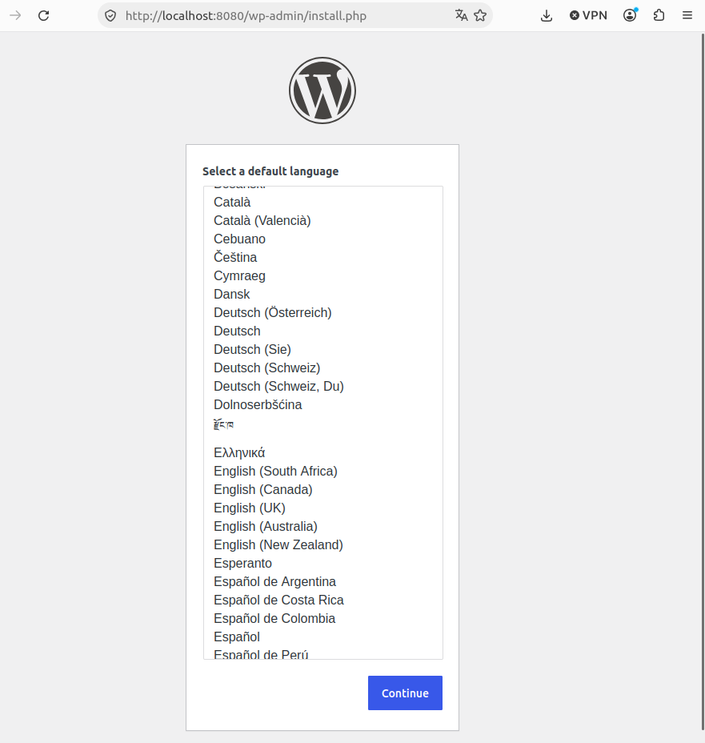
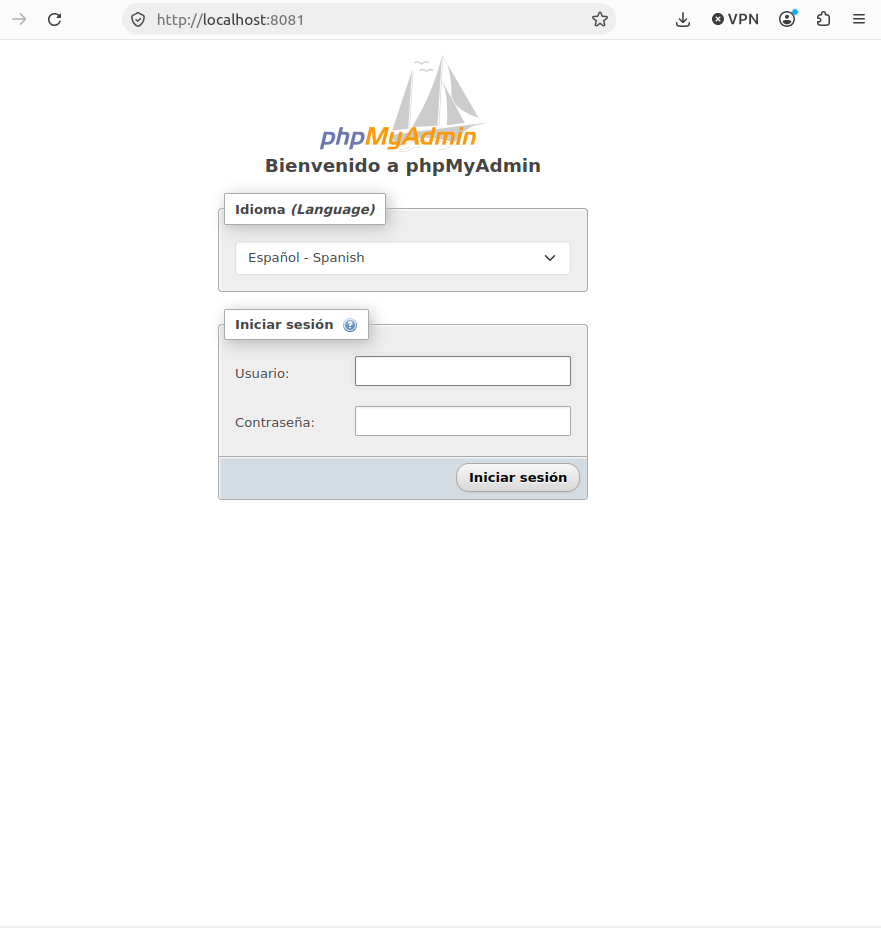

# DOCKER

### PUNTO 1A

Crea y ejecuta un contenedor a partir de la imagen de nginx con las siguientes
características:

**● Nombre: webserver.**
**● Mapeo de puertos: el 80 del contenedor al 8080 del anfitrión.**
**● Que se ejecute en segundo plano.**




```bash
docker run  # Crea y arranca un contenedor.
-d # Para que se ejecute en segundo plano.
--name webserver # Asignarle el nombre a el contenedor.
-p 8080:80 #Definimos el puerto.
nginx #La imagen que vamos a usar (Si no existe se descarga automaticamente).
docker ps # Verificamos que esta funcionando.
```

Accede a la web desde Firefox para que se vea.



---

### PUNTO 1B

Ahora abre un terminal interactivo con el contenedor y cambia la página web que
se ve por defecto, que está en “/usr/share/nginx/html” por una que muestre un
título y una imagen.

La imagen tendrás que copiarla desde el anfitrión al contenedor y meterla en la
carpeta correspondiente para que se vea en la web.

Aqui copiamos la imagen, y la metemos dentro del contenedor.


Abrimos la linea de comandos del contenedor webserver, nos movemos a la ruta donde tenemos el html y la foto copiada anterior mente y cpn el cat suministramos el codigo HTML que yo lo he sacado de internet.



Al buscar la pagina desde el **FIREFOX** y se ve asi


### PUNTO 2

Utilizando las imágenes oficiales de Docker de Wordpress y MySQL monta una
página web con Wordpress funcional.
Después añade un contenedor con phpmyadmin que permita la administración de
la base de datos.

Creamos una **RED**


Creamos un contenedor de **MYSQL**


```php
MYSQL_ROOT_PASSWORD	#Contraseña del usuario administrador (root)
MYSQL_DATABASE	#Crea automáticamente la base de datos wordpress
MYSQL_USER / MYSQL_PASSWORD	#Crea un usuario normal para WordPress
```

Ahora vamos a crear el contenedor de wordprees, le asignamos la red el nombre y los parametros que aparecen en la captura: 


Ahora dede **FIREFOX** hemos entrado al puerto 80 y nos visualiza el wordprees


Y ahora entramos a el puerto 81 y vemos el **phpMyAdmin**
